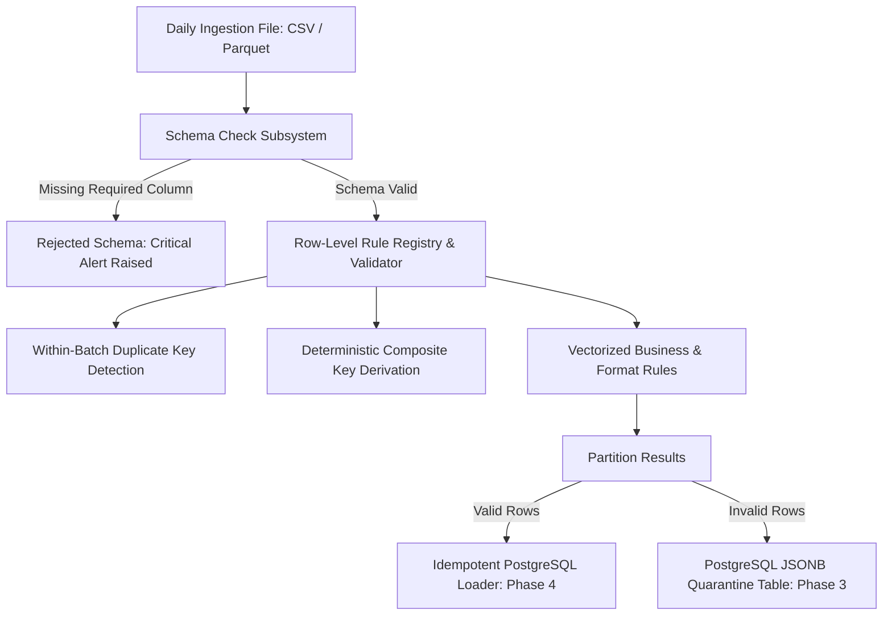
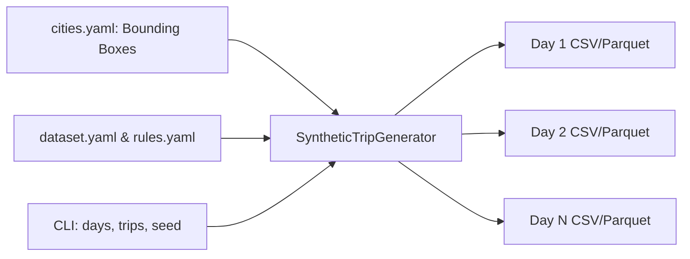
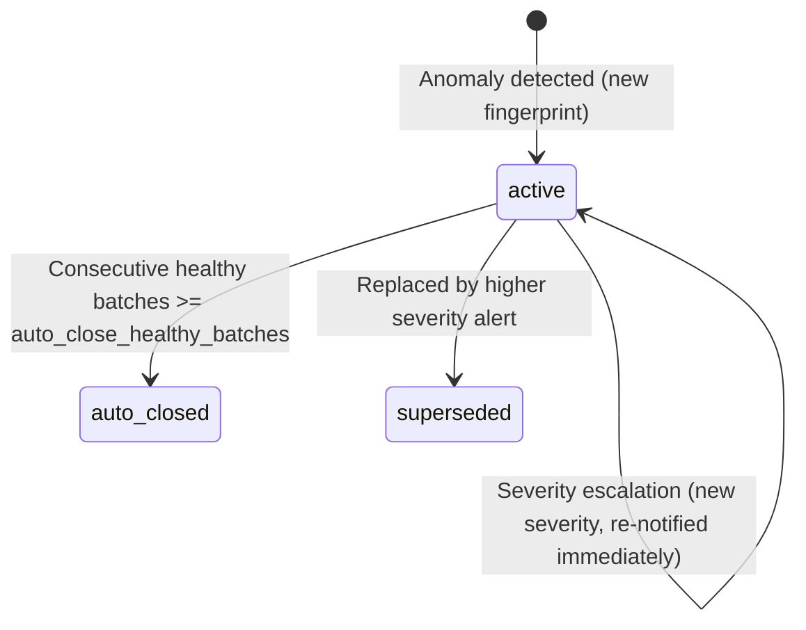
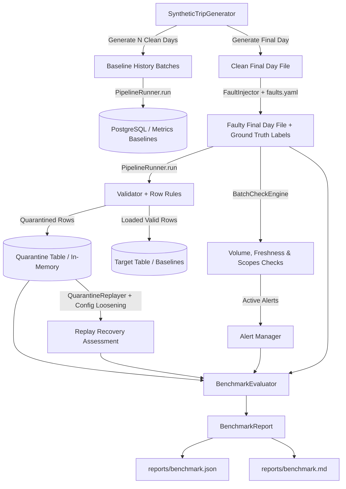

# PulseCheck Architecture & Core Components

This document describes the architectural components, execution pipelines, and data flows implemented in PulseCheck.

---

## 1. High-Level Processing Flow



---

## 2. Subsystem Details

### A. Configuration & Strict Schemas (`src/pulsecheck/config/`)
PulseCheck is strictly driven by declarative configuration files:
- `config/dataset.yaml`: Physical-to-semantic column mapping, primary/composite key definitions, unknown column policies (`reject`, `warn`, `ignore`), chunk sizes, and conflict resolution modes (`skip`, `update`, `quarantine`).
- `config/rules.yaml`: Enabled row-level rules, diagnostic reason codes, severity levels, and numeric parameter thresholds.
- `config/checks.yaml`: Batch-level statistical checks (weekday volume median, freshness lag, missing scopes) and alert suppression windows.
- `config/cities.yaml`: Bounding boxes for reference cities.

All configuration files are validated at startup using strict Pydantic v2 models (`StrictBaseModel` with `extra="forbid"`). Unknown keys, wrong types, or missing required attributes fail fast before any ingestion processing begins.

### B. Injectable Clock Protocol (`src/pulsecheck/clock.py`)
To prevent non-deterministic pipeline behavior during replays, simulations, and unit tests, business logic never accesses `datetime.now()` directly. Instead, an injectable `Clock` protocol is supplied:
- `SystemClock`: Reads the current wall-clock in timezone-aware UTC.
- `FrozenClock`: Freezes time to an immutable UTC timestamp for unit tests and backfill evaluations.

### C. Batch Schema Enforcement (`src/pulsecheck/schema_check.py`)
Before row validation or database writes occur, the incoming file's columns are verified against the configured schema:
1. **Required Columns**: Any column defined in `columns` with `nullable: false` that is absent causes the batch to immediately abort with status `rejected_schema`. No rows are loaded into target or quarantine tables.
2. **Unknown Columns**: Handled according to `unknown_columns_policy`:
   - `reject`: Rejects the batch immediately (`rejected_schema`).
   - `warn`: Logs a warning and continues processing (`has_warnings`).
   - `ignore`: Disregards unconfigured columns and continues (`passed`).

### D. Third-Party Adapters (`src/pulsecheck/adapters/`)
Third-party libraries are isolated behind adapter interfaces:
- `indpy_adapter`: Wraps `indpy` to validate and synthetically generate authentic Indian phone numbers, postal PIN codes, and vehicle registration plates.
- `pandera_adapter`: Wraps `pandera.pandas` to build dynamic `DataFrameSchema` instances and validate pandas DataFrames.

### E. Row Rule Registry (`src/pulsecheck/rules/`)
The rule registry (`registry`) manages pluggable validation functions. Each registered rule declares:
- `rule_id`: Programmatic identifier (e.g. `RULE_CHRONOLOGY`).
- `reason_code`: Diagnostic code (e.g. `ERR_INVALID_CHRONOLOGY`).
- `required_roles`: Semantic roles required for evaluation (e.g. `["pickup_time", "delivery_time"]`).
- `func`: Vectorized evaluation function returning a boolean Series (`True` indicating rule failure).

**Automatic Rule Skipping**: If the incoming dataset lacks any role required by an enabled rule, the validator automatically skips that rule, logs the exact reason, and records the skip in the execution summary without aborting other checks.

### F. Validation Engine & Key Derivation (`src/pulsecheck/validator.py`)
- **Key Derivation**: If a single role is configured, the key is the string representation of that column. If composite roles are configured, roles are sorted lexicographically, normalized to strings, concatenated, and hashed via SHA-256 to ensure order-independent determinism.
- **Duplicate Key Detection**: The first occurrence of a key within a batch passes; subsequent duplicate occurrences are assigned `ERR_DUPLICATE_KEY`.
- **Multi-Failure Retention**: A row violating multiple rules (e.g. inverted chronology AND invalid phone format) collects all applicable diagnostic reason codes in its quarantine payload.

---

## 3. Database Architecture & Table Schemas

All tables are initialized via `pulsecheck init-db` (safe to execute multiple times). Safe identifiers (`psycopg.sql.Identifier`) and whitelisted PostgreSQL types are enforced.

### A. Batch Registry (`batch_registry`)
Tracks every ingested batch, its deterministic identity, and lifecycle status.
```sql
CREATE TABLE IF NOT EXISTS batch_registry (
    batch_id VARCHAR(64) PRIMARY KEY,
    source VARCHAR(64) NOT NULL,
    logical_date DATE NOT NULL,
    file_hash VARCHAR(64) NOT NULL,
    status VARCHAR(32) NOT NULL,
    started_at TIMESTAMPTZ NOT NULL,
    completed_at TIMESTAMPTZ,
    error_message TEXT
);
CREATE INDEX IF NOT EXISTS idx_batch_registry_source_date ON batch_registry (source, logical_date);
CREATE INDEX IF NOT EXISTS idx_batch_registry_file_hash ON batch_registry (file_hash);
```

### B. Batch Metrics (`batch_metrics`)
Stores summary counts and timing statistics per batch and scope.
```sql
CREATE TABLE IF NOT EXISTS batch_metrics (
    id BIGSERIAL PRIMARY KEY,
    batch_id VARCHAR(64) NOT NULL REFERENCES batch_registry(batch_id),
    source VARCHAR(64) NOT NULL,
    scope VARCHAR(64),
    rows_received INT NOT NULL,
    rows_loaded INT NOT NULL,
    rows_quarantined INT NOT NULL,
    rows_duplicate INT NOT NULL,
    latest_event_time TIMESTAMPTZ,
    duration_seconds DOUBLE PRECISION,
    created_at TIMESTAMPTZ NOT NULL DEFAULT NOW()
);
CREATE INDEX IF NOT EXISTS idx_batch_metrics_batch_id ON batch_metrics (batch_id);
CREATE INDEX IF NOT EXISTS idx_batch_metrics_source_scope ON batch_metrics (source, scope);
```

### C. Quarantine Table (`quarantine`)
Retains rejected rows with their exact JSON payloads and diagnostic reasons array.
```sql
CREATE TABLE IF NOT EXISTS quarantine (
    id BIGSERIAL PRIMARY KEY,
    batch_id VARCHAR(64) NOT NULL,
    source VARCHAR(64) NOT NULL,
    row_number INT NOT NULL,
    record_key VARCHAR(64) NOT NULL,
    raw_row JSONB NOT NULL,
    reasons JSONB NOT NULL,
    scope VARCHAR(64),
    status VARCHAR(32) NOT NULL DEFAULT 'open',
    attempts INT NOT NULL DEFAULT 0,
    created_at TIMESTAMPTZ NOT NULL DEFAULT NOW(),
    updated_at TIMESTAMPTZ NOT NULL DEFAULT NOW()
);
CREATE INDEX IF NOT EXISTS idx_quarantine_reasons_gin ON quarantine USING GIN (reasons);
CREATE INDEX IF NOT EXISTS idx_quarantine_record_key ON quarantine (record_key);
CREATE INDEX IF NOT EXISTS idx_quarantine_batch_id ON quarantine (batch_id);
CREATE INDEX IF NOT EXISTS idx_quarantine_status ON quarantine (status);
```

### D. Alerts Table (`alerts`)
Deduplicates and tracks raised operational anomalies and check failures.
```sql
CREATE TABLE IF NOT EXISTS alerts (
    id BIGSERIAL PRIMARY KEY,
    fingerprint VARCHAR(64) UNIQUE NOT NULL,
    check_name VARCHAR(64) NOT NULL,
    scope VARCHAR(64),
    severity VARCHAR(32) NOT NULL,
    message TEXT NOT NULL,
    occurrence_count INT NOT NULL DEFAULT 1,
    first_seen_at TIMESTAMPTZ NOT NULL DEFAULT NOW(),
    last_seen_at TIMESTAMPTZ NOT NULL DEFAULT NOW(),
    resolved_at TIMESTAMPTZ
);
CREATE INDEX IF NOT EXISTS idx_alerts_check_scope ON alerts (check_name, scope);
```

### E. Target Data Table (e.g. `trips`)
Generated dynamically from `config/dataset.yaml`. Safe identifiers and type mapping applied:
- Configured columns (`trip_id`, `driver_id`, `pickup_time`, `fare_inr`, etc.)
- `record_key VARCHAR(64) NOT NULL` (Surrogate unique key across single or composite identity roles)
- `_loaded_at TIMESTAMPTZ NOT NULL DEFAULT NOW()`
- `CONSTRAINT {table}_record_key_uniq UNIQUE (record_key)`
- `CONSTRAINT {table}_pk PRIMARY KEY ({pk_col})` (if single identity role configured)

---

## 4. Ingestion & Load Flow

```
+-------------------------------------------------------------------------+
|                              pulsecheck run                             |
+-------------------------------------------------------------------------+
                                    |
            1. Compute File Hash (SHA-256) & Batch ID
            2. Check batch_registry for duplicate file
               - If 'completed' and repeated_file_policy == 'skip': Return
                                    |
            3. Register batch in batch_registry (status = 'running')
                                    |
            4. Stream Chunks (CSV / Parquet Reader)
               - Chunk 0: Verify schema (missing required -> abort batch)
               - For each chunk:
                 * Validate rows with Rule Registry
                 * Partition into Valid Rows and Invalid Rows
                 * Write Invalid Rows to quarantine table (raw_row, reasons)
                 * Insert Valid Rows via IdempotentLoader (ON CONFLICT)
                   - skip: DO NOTHING RETURNING record_key
                   - update: DO UPDATE SET ... RETURNING record_key
                   - quarantine: DO NOTHING -> route collisions to quarantine
                 * Resolve open quarantine entries for loaded keys:
                   UPDATE quarantine SET status = 'resolved_by_load'
                   WHERE record_key = ANY(%s) AND status = 'open'
                 * Commit per chunk (if transaction_scope == 'chunk')
                                    |
            5. Insert Batch Metrics into batch_metrics
            6. Mark batch_registry status = 'completed'
            7. Commit transaction (if transaction_scope == 'batch')
            8. Print formatted execution summary
```

---

## 5. Batch Identity & Deduplication

Batch identity is determined by three immutable properties:
1. `source`: Ingestion provider or feed name (e.g. `partner_logistics`).
2. `logical_date`: Ingestion business date (YYYY-MM-DD).
3. `file_hash`: SHA-256 hexadecimal digest of the raw incoming file bytes.

Formula:
$$\text{batch\_id} = \text{SHA256}(\text{source} \,\|\, \text{logical\_date} \,\|\, \text{file\_hash})[:32]$$

If an identical file hash has already been marked as `completed` in `batch_registry`:
- `repeated_file_policy: skip`: Ingestion halts immediately without re-reading or altering data tables.
- `repeated_file_policy: reprocess`: Re-evaluates file under the configured `conflict_policy`.

---

## 6. Chunked File Readers

PulseCheck supports both delimited CSV and binary Apache Parquet through a unified `FileReader` interface:
- **CSV Reader (`CSVReader`)**: Uses `pandas.read_csv(..., chunksize=chunk_size)` with configurable delimiters, header options, and string preservation.
- **Parquet Reader (`ParquetReader`)**: Uses `pyarrow.parquet.ParquetFile(path).iter_batches(batch_size=chunk_size)` to stream record batches into DataFrames without reading the entire dataset into RAM. Guarantees deterministic file handle closure for Windows compatibility.

---

## 7. Synthetic Data Generator (`src/pulsecheck/generator/`)

The synthetic data generator produces clean, fully schema-compliant logistics trip datasets for benchmarking, testing, and baseline modeling.

### Core Principles
1. **Zero False-Alarm Baseline**: Generates pristine trips that strictly comply with all enabled row rules (coordinates inside city bounding box with safety margins, positive durations under configured ceilings, speeds computed via Haversine below 150 km/h, valid Indian national identifiers from `indpy_adapter`).
2. **Deterministic Multi-Day Simulation**: Seeded via a configured or CLI parameter (`--seed`). Seeding global `random`, local `Random`, and `Faker` guarantees identical output across repeated runs while different seeds produce varying distributions.
3. **Realistic Logistics Modeling**: Simulates diurnal pickup distributions (06:00 to 22:00 UTC), city-specific trip densities, and configurable weekday multipliers (e.g. higher weekday commercial traffic vs. lower weekend volumes).



---

## 8. Fault Injection Engine & Labels Format (`src/pulsecheck/faults/`)

The fault injection subsystem introduces controlled data quality defects and anomalies into clean datasets, producing mutated files alongside verifiable ground-truth labels.

### Plugin Architecture
Each fault type implements the `FaultPlugin` protocol:
```python
class FaultPlugin(Protocol):
    def apply(
        self,
        df: pd.DataFrame,
        fault_cfg: FaultConfig,
        context: Dict[str, Any],
    ) -> Tuple[pd.DataFrame, InjectedFaultRecord]: ...
```

### Supported Fault Types
| Fault Name | Scope | Expected Detector | Target Description |
|---|---|---|---|
| `null_id` | rows | `RULE_REQUIRED_VALUES` | Nullifies primary key / trip ID |
| `swapped_times` | rows | `RULE_CHRONOLOGY` | Inverts delivery time before pickup time |
| `swapped_lat_lon` | rows | `RULE_COORDINATES_RANGE` | Transposes latitude and longitude values |
| `out_of_box_coordinates` | rows | `RULE_GEO_BOUNDING_BOX` | Shifts coordinates beyond city bounding box |
| `bad_mobile` | rows | `RULE_PHONE_FORMAT` | Replaces driver mobile with invalid format |
| `bad_pin` | rows | `RULE_PINCODE_FORMAT` | Replaces postal code with invalid PIN |
| `bad_plate` | rows | `RULE_PLATE_FORMAT` | Replaces vehicle registration with invalid plate |
| `duplicate_ids` | rows | `RULE_DUPLICATE_KEY` | Duplicates existing record keys |
| `future_timestamps` | rows | `RULE_FUTURE_TIMESTAMP` | Sets event timestamps in future relative to clock |
| `dropped_required_column` | rows | `SCHEMA_CHECK` | Drops a required non-nullable column |
| `missing_city` | batch | `volume_anomaly` | Omits all trips for a specific city |
| `volume_drop` | batch | `volume_anomaly` | Slashes trip count for a scope by configured ratio |
| `stale_batch` | batch | `freshness_anomaly` | Shifts all batch timestamps into the past |

### Ground-Truth Labels File Schema (`<filename>.labels.json`)
Every injection run automatically exports an accompanying JSON labels file matching each defect to its ground-truth affected rows and expected detector:

```json
{
  "source_file": "data/trips_20260301.csv",
  "faulty_file": "data/trips_20260301_faulty.csv",
  "seed": 42,
  "injected_faults": {
    "bad_mobile": {
      "expected_detector": "RULE_PHONE_FORMAT",
      "scope": "rows",
      "affected_row_ids": [
        "TRIP_20260301_MUM_000004",
        "TRIP_20260301_BLR_000012"
      ],
      "affected_scopes": [],
      "count": 2,
      "details": {
        "target_column": "driver_phone"
      }
    },
    "missing_city": {
      "expected_detector": "volume_anomaly",
      "scope": "batch",
      "affected_row_ids": [],
      "affected_scopes": ["Bengaluru"],
      "count": 1,
      "details": {
        "omitted_city": "Bengaluru"
      }
    }
  }
}
```

---

## 9. Quarantine Lifecycle, Replay, Diagnostics & Export

PulseCheck provides a comprehensive remediation loop for quarantined records without data loss or pipeline interruption.

### A. Quarantine Status Transitions

```mermaid
stateDiagram-v2
    [*] --> open : Row fails validation during run
    open --> replayed : pulsecheck replay (row now passes CURRENT config)
    open --> open : pulsecheck replay (row still fails; attempts incremented)
    open --> resolved_by_load : pulsecheck run (corrected file loaded idempotently)
    open --> dismissed : manual dismissal
```



- **`open`**: Default state upon quarantine ingestion.
- **`replayed`**: Row successfully re-validated against updated/loosened rules via `pulsecheck replay` and idempotently committed to the target table.
- **`resolved_by_load`**: Corrected row re-submitted via `pulsecheck run` and loaded into the target table, automatically resolving the open quarantine entry.
- **`dismissed`**: Manually marked terminal without loading into the target table.

### B. Replay Flow (`pulsecheck replay`)
Re-evaluates open quarantine records using the **CURRENT** active configuration:
1. **Filtering**: Selects open entries matching `--batch`, `--reason`, `--scope`, and `--status` (default: `open`).
2. **Current Rule Evaluation**: Converts JSONB `raw_row` into pandas DataFrame and applies current rules.
3. **Dry-Run Mode (`--dry-run`)**: Evaluates valid/invalid transitions without mutating database tables or incrementing counters.
4. **Target Ingestion**: Valid rows are inserted into the target data table using `IdempotentLoader`.
5. **State Updates**:
   - Now-valid rows transition to `status = 'replayed'`.
   - Still-failing rows remain `open`, increment `attempts = attempts + 1`, and refresh diagnostic `reasons`.
6. **Reporting**: Prints real before/after transition counts.

### C. Diagnostics Engine (`pulsecheck diagnose`)
Aggregates quarantined records to detect operational patterns and anomalies:
- **Grouping**: Groups records by diagnostic reason code, source, scope, and logical date.
- **Shares & Rankings**: Calculates percentage shares of total defects for each cause.
- **Concentration Flagging**: Evaluates whether defects are disproportionately concentrated in a single source or day exceeding thresholds in `config/checks.yaml` (`max_source_share`, `max_day_share`).

### D. Rejection Export (`pulsecheck export-rejects`)
Generates actionable remediation files for data suppliers:
- Extracts original column values from `raw_row`.
- Appends `quarantine_reason` containing human-readable explanations (e.g., `"Pickup time is after delivery time (inverted chronology)"`).
- Appends quarantine metadata columns: `quarantine_id`, `quarantine_scope`, `quarantine_batch_id`.
- Data owners correct the values and re-submit the file via `pulsecheck run`.

---

## 10. Batch-Level Verification Checks & Alert Subsystem (`src/pulsecheck/checks/`)

Batch checks evaluate macro-level trends, cross-batch statistical consistency, data freshness, and operational completeness.

### A. Core Batch Checks
1. **Volume Anomaly Check (`VolumeChecker`)**:
   - Compares the loaded rows for each `(source, scope)` against the median of the last $N$ completed batches having the **same weekday** from `batch_metrics`.
   - **Ratio Bounds**: Evaluates $R = \text{rows} / \text{median}$. Flagged if $R < \text{min\_volume\_ratio}$ (default: 0.50) or $R > \text{max\_volume\_ratio}$ (default: 2.00).
   - **Weekday Sensitivity**: Prevents false alarms on low-volume weekend feeds when historical weekends were similarly low.
   - **Fallback Rule**: When fewer than `minimum_history_batches` exist, falls back to absolute thresholds `[fallback_absolute_min_rows, fallback_absolute_max_rows]`.
   - **Zero-Baseline Handling**: Explicitly handles historical zero medians: 0 rows against 0 baseline passes; volume $>0$ against zero baseline triggers an anomaly alert.
2. **Missing Scopes Check (`MissingScopesChecker`)**:
   - Queries distinct operational scopes (cities) observed in the lookback window (`lookback_batches`, default: 7).
   - Any scope present in recent history but absent in the current batch is flagged with `rows = 0` and raises a `CRITICAL` alert (`missing_scope`).
3. **Freshness & Future Timestamp Check (`FreshnessChecker`)**:
   - Assesses the latest event timestamp in the batch against the injectable `Clock` in timezone-aware UTC.
   - **Stale Feed**: If $(\text{clock} - \text{latest}) > \text{max\_lag\_seconds}$ (default: 24h), raises `freshness_anomaly`.
   - **Future Timestamps**: If $\text{latest} > \text{clock} + 60\text{s}$, raises `future_timestamp` with `CRITICAL` severity.

### B. Alert Lifecycle & State Transitions



- **Fingerprint**: Deterministic identifier `check_name:scope:severity`.
- **Cooldown Window**: Suppresses alert storms when the same anomaly recurs within `cooldown_seconds`.
- **Severity Escalation**: If a higher severity occurs for the same check and scope, the cooldown is bypassed and immediate notification is dispatched.
- **Auto-Close**: Active alerts track `healthy_batch_count`. Once the scope passes $N$ consecutive batches without re-triggering, the alert transitions to `status = 'auto_closed'` with `resolved_at = NOW()`.
- **Channels**: Log (standard logger), Table (`alerts` PostgreSQL table), and Webhook (HTTP POST payload only if `ALERT_WEBHOOK_URL` is configured).

---

## 11. Synthetic Benchmark Engine (`src/pulsecheck/benchmark/`)

The benchmark subsystem provides an automated, end-to-end evaluation harness executed via `pulsecheck benchmark`. It measures detection efficacy, false alarm rates, and quarantine recovery against synthetic ground truth.

### A. Benchmark Flow Architecture



### B. Detection Matching & Scoring Logic

1. **Row-Level Fault Matching**:
   - Each injected fault record provides `affected_row_ids` and `expected_detector`.
   - **Caught (True Positives)**: Quarantined rows whose ID matches an injected row and contains the expected reason code.
   - **Missed (False Negatives)**: Injected rows that did not trigger the expected reason code.
   - **False Alarms (False Positives)**: Quarantined rows triggering the detector code that were not in the fault's `affected_row_ids`.
   - **Precision**: $P = \frac{\text{Caught}}{\text{Caught} + \text{False Alarms}}$ (default $1.0$ if zero detections).
   - **Recall**: $R = \frac{\text{Caught}}{\text{Injected}}$ (default $1.0$ if zero injected).

2. **Batch-Level Fault Matching**:
   - Compares batch alert check names and affected scopes against injected batch anomalies (`missing_city`, `volume_drop`, `stale_batch`).
   - Alerts on non-targeted scopes are counted as false alarms.

3. **Overall Pipeline Metrics**:
   - **Clean Rows Wrongly Quarantined**: Rows in the clean dataset not mutated by any fault that were quarantined.
   - **Alerts on Clean Scopes**: Batch check alerts raised on operational scopes unaffected by batch faults.
   - **Replay Recovery**: Evaluates how many quarantined rows are remediated and recovered via `QuarantineReplayer` after applying the configured fix (e.g., config rule loosening or corrected data).

---

## 12. Real-World Pipeline Profile: NYC TLC Trip Records (Zero-Code Ingestion)

PulseCheck demonstrates declarative portability by ingesting 2.96 million real NYC TLC Yellow Taxi records (`yellow_tripdata_2024-01.parquet`) using **configuration edits only** (`config/tlc/`):

### A. Role Mapping Architecture
Rather than modifying Python logic, physical Parquet columns are mapped to semantic roles:
- `VendorID` $\rightarrow$ role `id` (primary identity component)
- `tpep_pickup_datetime` $\rightarrow$ role `pickup_time`
- `tpep_dropoff_datetime` $\rightarrow$ role `delivery_time`
- `PULocationID` $\rightarrow$ role `scope` (Taxi Zone ID mapped to operational partition scope)
- `DOLocationID` $\rightarrow$ role `dropoff_scope`
- `fare_amount` $\rightarrow$ role `fare`
- `trip_distance` $\rightarrow$ role `distance`

### B. Composite Identity & Collision Handling
Because TLC data has no natural single-column primary key, PulseCheck derives a deterministic composite surrogate key:
$$\text{Key} = \text{SHA256}\left(\text{dropoff\_scope} \mid \text{fare} \mid \text{id} \mid \text{pickup\_time} \mid \text{scope}\right)$$
- **Collision Rate**: 615 rows out of 2,964,624 (0.0207%), representing true meter duplicate re-transmissions.
- Intra-batch deduplication accepts the first arrival and quarantines duplicates under `ERR_DUPLICATE_KEY`.

### C. Selective Rule Execution & Skipped Roles
- **Rules Evaluated**: `RULE_REQUIRED_VALUES`, `RULE_TYPE_PARSING`, `RULE_CHRONOLOGY`, `RULE_MAX_DURATION` (14,400s), `RULE_MAX_SPEED` (80 mph / 128.7 km/h), `RULE_DUPLICATE_KEY`.
- **Rules Skipped**: Rules requiring missing roles (`lat`, `lon`, `city`, `phone`, `pincode`, `plate`) are skipped cleanly with logged explanations without halting batch execution.

