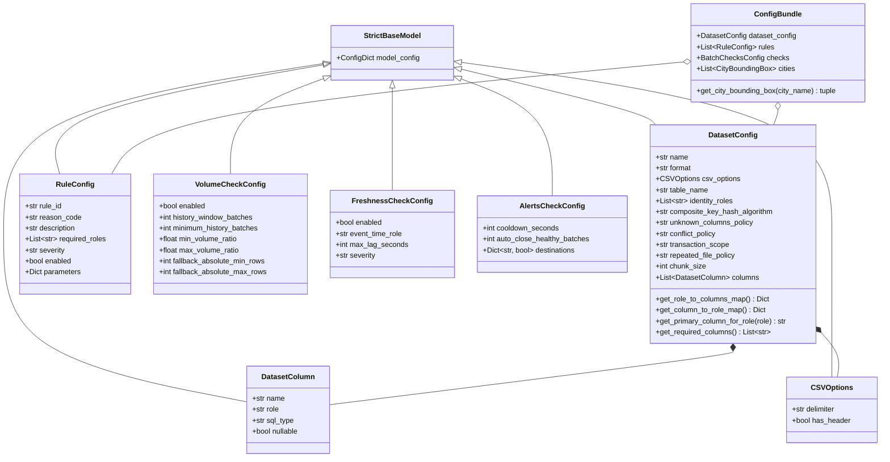
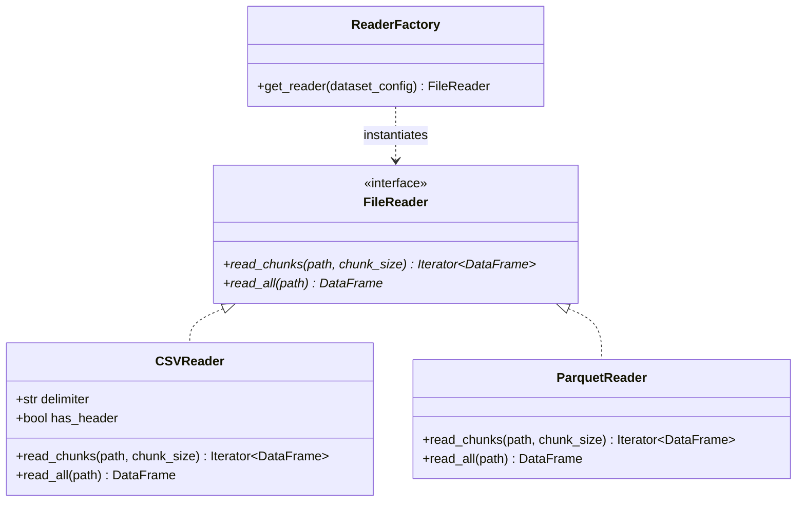
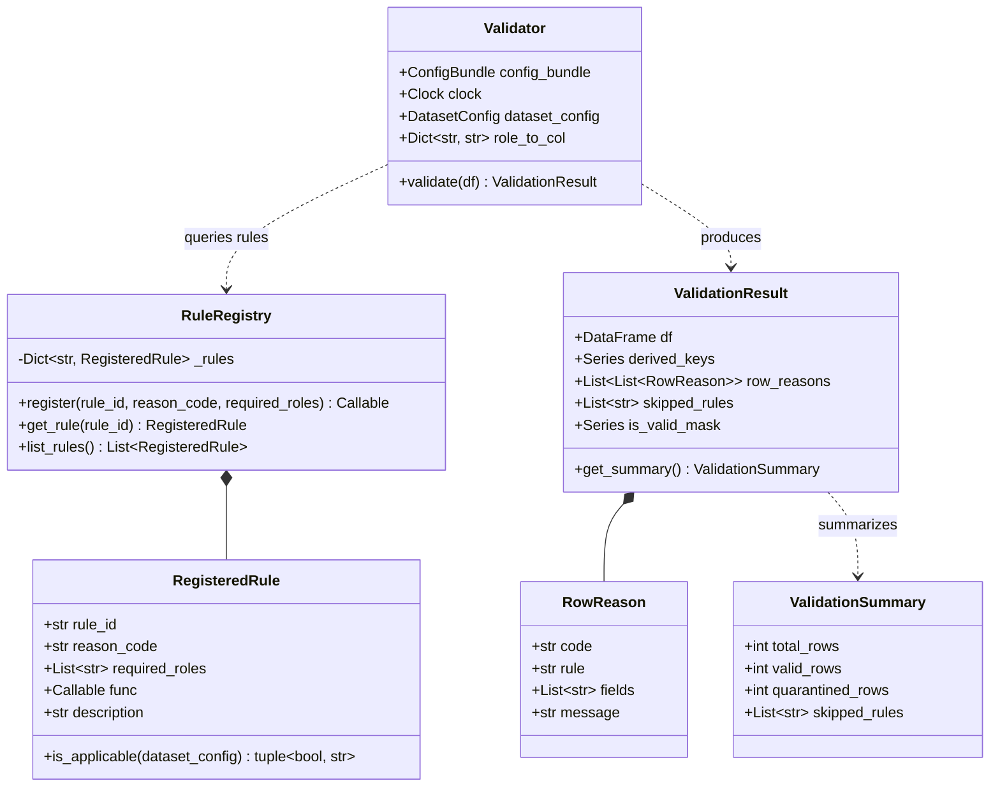
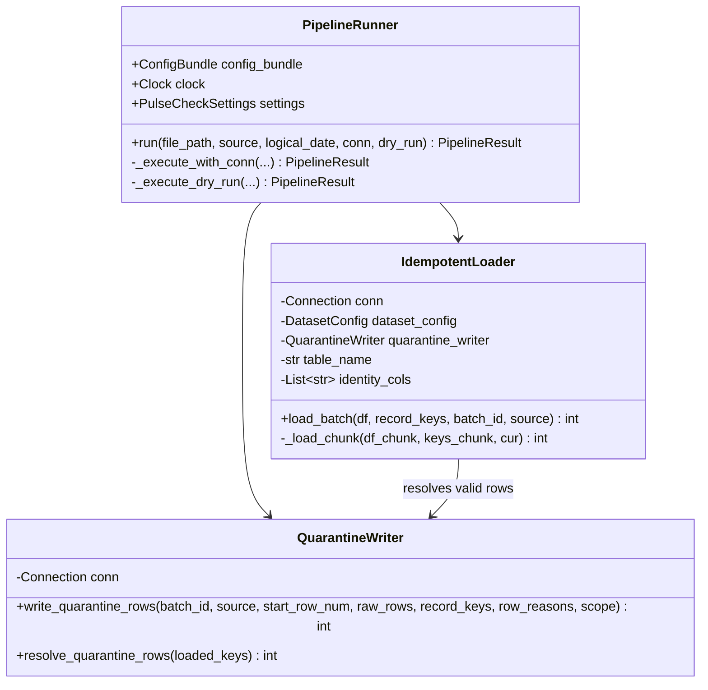
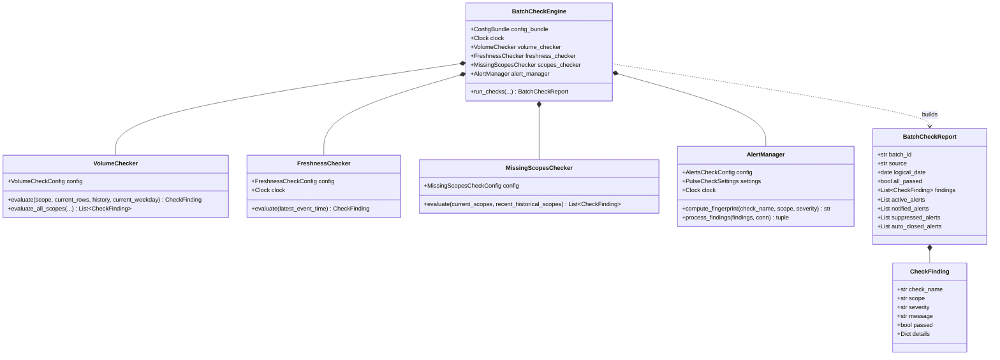
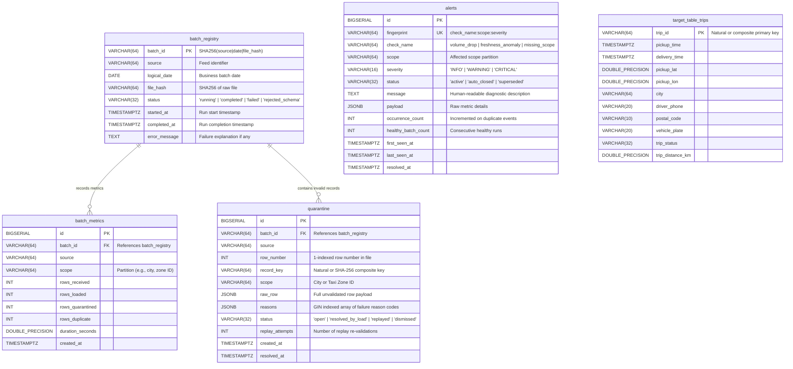
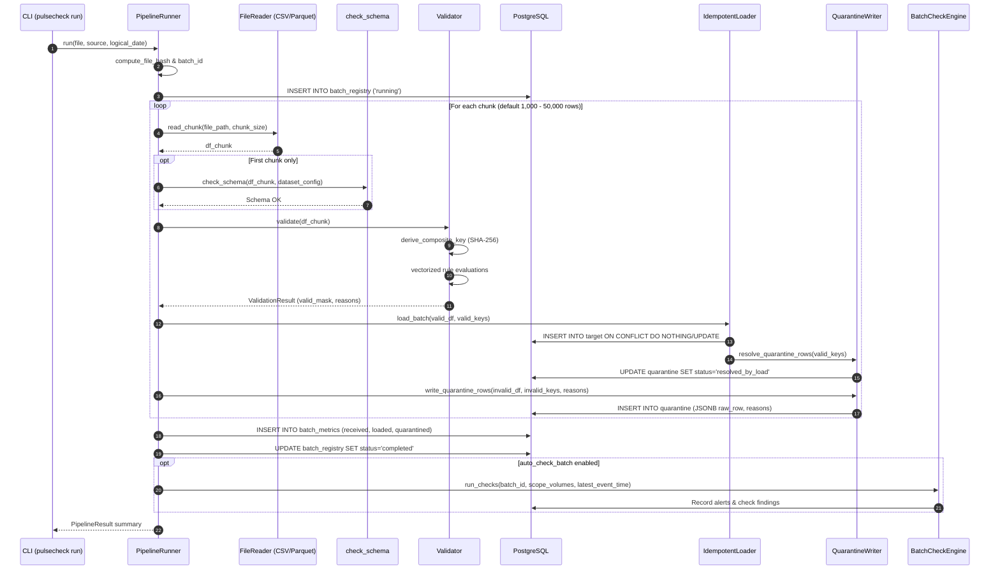
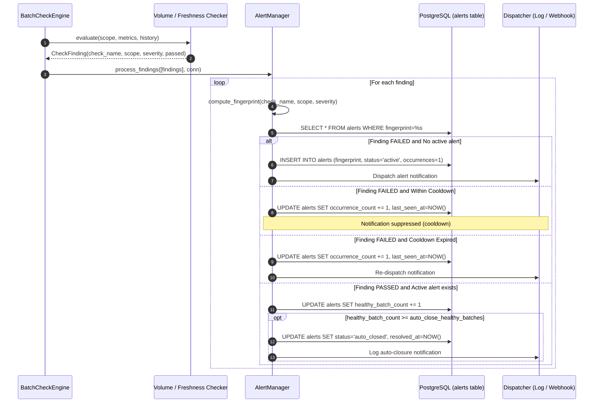
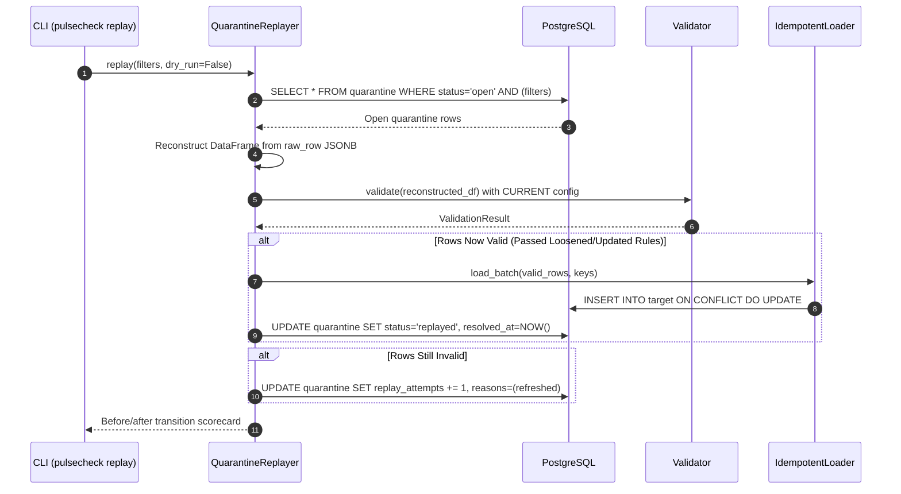

# PulseCheck Low-Level Design (LLD) & Class Diagrams

This document details the low-level design, class hierarchies, entity relationships, and execution sequences for PulseCheck.

---

## 1. Subsystem Class Diagrams

### A. Configuration & Schema Models (`src/pulsecheck/config/`)

---

### B. Ingestion Readers & Chunking (`src/pulsecheck/readers/`)

---

### C. Validation Engine, Registry & Rule Protocol (`src/pulsecheck/rules/`, `src/pulsecheck/validator.py`)

---

### D. PostgreSQL Ingestion Loader & Quarantine Writer (`src/pulsecheck/`)

---

### E. Batch Checks, Anomaly Detectors & Alert Deduplication (`src/pulsecheck/checks/`)

---

## 2. Entity-Relationship Diagram (PostgreSQL)

---

## 3. Core Execution Sequences

### A. End-to-End Ingestion Pipeline (`pulsecheck run`)

---

### B. Alert Lifecycle, Cooldown & Escalation

---

### C. Quarantine Replay & Self-Healing Loop (`pulsecheck replay`)

